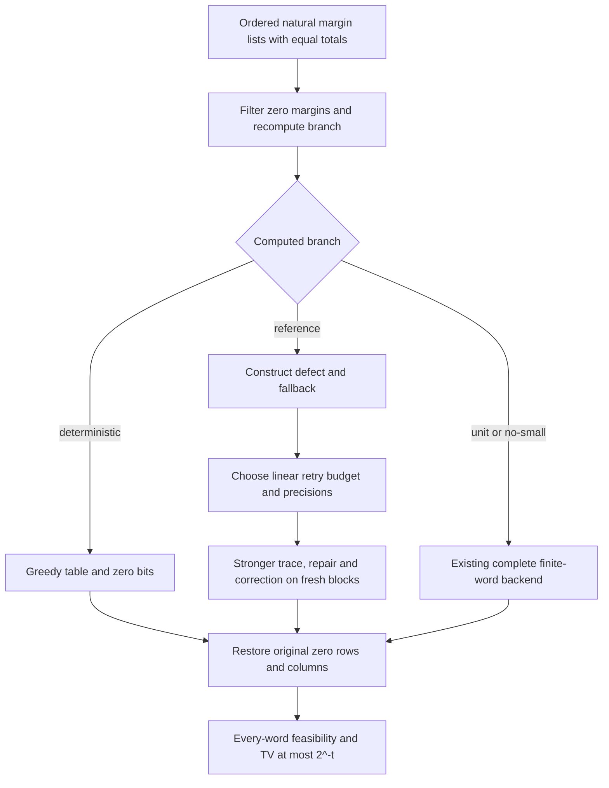

# All-input finite-word sampler using the stronger reference chain

The newer reference chain now has an initialized, automatically scheduled
finite-word sampling specification. An all-input dispatcher uses that map
on its computed reference branch, a zero-bit constant output on deterministic
shapes, and the existing checked sampler on the remaining shapes. For every
pair of equal-total natural margin lists and every natural precision t,
every word returns a feasible ordinary table and the uniform-word output
law is within 2^-t of uniform ordinary tables on the original ordered lists.

The theorem identifies a typed map and its reserved finite bit bank. Parts
of the typed map use noncomputable semantic constructions. The [complete ordinary list program](executable-sampler.md) now has a checked
pointwise correspondence to this typed map. Its revised encoded machine,
charged running time and strict Comparator acceptance remain separate work. The existing
complete encoded d^17 sampler and its runtime certificate are unchanged.

## What the construction supplies

Stable filtering removes zero rows and columns while preserving order.
All scales, small-cell catalogs and branch tests are rebuilt on those
positive lists. The table equivalence restores the original zero positions
exactly and preserves both uniformity and total variation.

In the reference branch, the existing greedy construction supplies a
feasible reduced table. An explicit row-major list of ordered label pairs
is searched with the checked ordinary support/slack predicate. The positive
inverse-count bound proves that this search finds a pair. The actual inverse
construction then supplies a positive-weight physical defect, including a
completion witness. No starting state or fallback is supplied by the caller.
The search and greedy fallback are computational definitions; the inherited
typed inverse construction remains noncomputable.

Each corrected trial runs the scheduled stronger trace and a fresh terminal
completion, retains that completion during repair, checks padding, and uses
a separate bounded-bit correction coin. The whole option-valued law is
controlled before retries; padding failures remain failures. A single flat
word splits bijectively into disjoint complete trial blocks. The first
successful trial wins, even when its value equals the fallback; only failure
advances to another block. Exhausting all trials returns the original
feasible fallback.

## A linear retry allowance

Write p for the reduced small-cell count, a,b for the small-row and
small-column counts, and m,n for the reduced dimensions. The correction
numerator and ideal success allowance are

```
c0 = max(a*(n*a - 1), b*(m*b - 1))
s  = c0 / (2*p*(p - 1)).
```

Inclusion-exclusion gives `p+a*b=n*a+m*b`. The row and column bounds imply
`p-1 <= 2*c0`, including the cases where a or b is zero. Therefore, on the
reference branch where p>=2,

```
s >= 1/(4*p).
```

This sharpens an outer rejection allowance; it does not change the chain's
spectral gap. The automatic settings are

```
A = min(2*p*(p - 1), 4*p)
R = A*(t + 1)
H = t + 2 + ceil(log2 R)
```

Both per-trial precisions are H. The geometric failure term is at most
`2^-(t+1)`, and each of the two accumulated approximation terms is at most
`2^-(t+2)`. Their sum is at most `2^-t`. The reference branch reserves exactly

```
R * (terminalScheduleWordWidth(H) + H)
```

bits. The ordinary retry implementation maps all trial blocks before selecting
the first successful result. This theorem establishes the returned value and
reserved length, with no early-return or inspected-bit saving.

| Quantity | Initial safe schedule | Refined schedule |
|---|---|---|
| Retry block | `2*p*(p-1)` | `min(2*p*(p-1),4*p)` |
| Attempts | `2*p*(p-1)*(t+2)` | `min(2*p*(p-1),4*p)*(t+1)` |
| Both trial precisions | `t+3+ceil(log2 R)` | `t+2+ceil(log2 R)` |

The refined attempt count is proved no larger than the initial safe count
for every input, and its block is at most 4p. These are concrete retry
allowances; no new full reserved-bit degree in the public size measure or
machine-time comparison follows from this table.

## All branches and exact scope



The fallback backend rebuilds its own scales `U=5*d^3,L=3*d`. Its internal
branch need not match the newer classifier at `U=11*d*(m+n-2),L=7`.
The dispatcher makes no such identification. It proves that all inputs
are covered while the stronger trace is actually used on its reference
branch. New-scale unit and no-small algorithms can replace the fallback
later through the same output interface.

| English claim | Lean statement | Hypotheses |
|---|---|---|
| Construct actual reduced defect and fallback | `positiveTraceInitialStart`, `positiveTraceDefect_nonempty` | Equal original totals and computed reduced reference tag |
| Improved ideal success allowance | `positiveTraceCorrectionSuccess_linear` | Computed reduced reference tag |
| Linear block and no larger attempt count | `positiveTraceLinearBlock_le_linear`, `positiveTraceLinearAttempts_le_old` | Arbitrary margin lists and natural t for count comparison |
| Flat word has the exact independent retry law | `terminalCorrectedRetryWordLaw_eq` | Actual supplied defect and table, arbitrary R,h,k |
| Initialized, scheduled, flat reference output | `positiveReferenceWord_accuracy` | Equal original totals, computed reduced reference tag, natural t |
| Dispatcher selects the stronger reference map | `hybridSampler_reference` | Equal original totals and computed reduced reference tag |
| Complete typed output accuracy | `hybridWord_accuracy` | Equal original totals and natural t |
| Every word gives a feasible table | `hybridWord_feasible` | Equal original totals and a word of the computed width |

All names are in `Math115.PhysicalTraceJoin`. The headline sampling theorem
has no supplied start, fallback, accuracy assumption, success probability,
or choice of outer retry settings. It includes empty lists and zero totals.

## Verification and the next interface

The linked packets record ordinary Lean 4.34.1 compilation, full audits of
module declarations and headline dependency closures, and separate AI source
review. Only `propext`, `Classical.choice`, and `Quot.sound` occur in audited
closures. The pinned compiler and reused imports remain trusted. This is
an additive research scope; it does not extend historical hosted Linux
or Comparator receipts. Failed candidates and diagnostics remain available.

The next program obligation is a pointwise equation between a computational
list-coded draw and this typed map. It must preserve catalog order, the
initializer's two views, completion-retaining repair, padding failure,
acceptance, fresh banks and ordered zero restoration. Existing completion
program correspondences can be reused. After that, the changed machine
needs its own charged-cost composition and concrete comparison with upstream.

## Source-bound packets

| Packet | Passed receipt |
|---|---|
| [Initialization](../research/physical-trace-general-initialization/) | [attempt-02](../research/physical-trace-general-initialization/attempt-02/verification.json) |
| [Outer schedule](../research/physical-trace-general-outer-schedule/) | [attempt-02](../research/physical-trace-general-outer-schedule/attempt-02/verification.json) |
| [Retry word](../research/physical-trace-general-retry-word/) | [attempt-01](../research/physical-trace-general-retry-word/attempt-01/verification.json) |
| [Linear success](../research/physical-trace-general-linear-success/) | [attempt-02](../research/physical-trace-general-linear-success/attempt-02/verification.json) |
| [Linear schedule](../research/physical-trace-general-linear-schedule/) | [attempt-01](../research/physical-trace-general-linear-schedule/attempt-01/verification.json) |
| [Legacy fallback](../research/physical-trace-general-legacy-fallback/) | [attempt-03](../research/physical-trace-general-legacy-fallback/attempt-03/verification.json) |
| [Complete reference](../research/physical-trace-general-complete-reference/) | [attempt-01](../research/physical-trace-general-complete-reference/attempt-01/verification.json) |
| [Hybrid sampler](../research/physical-trace-general-hybrid-sampler/) | [attempt-02](../research/physical-trace-general-hybrid-sampler/attempt-02/verification.json) |

[Separate AI source and evidence review](../research/physical-trace-general-hybrid-sampler/AI-SOURCE-REVIEW.md).

The [four executable component correspondences](sampler-code-correspondence.md)
now close initialization, raw neighbor selection, terminal correction and
retained matrix reconstruction. They do not yet assemble the full encoded
trial. A [public dependency replay](../research/repair-accept/INTEGRATION-REPLAY.md)
resolves the integration sources and reuses the existing compiler/auditor.
